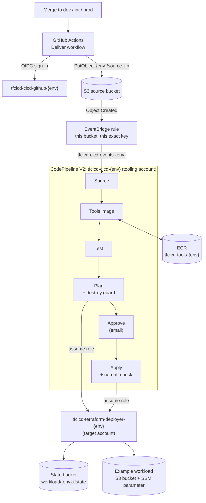

# terraform-cicd-aws

A working Terraform CI/CD pipeline on AWS, started by GitHub.

Merge to `dev`, `int` or `prod` and this happens: GitHub Actions uploads the code
to S3, and that environment's AWS CodePipeline tests it, plans it, waits for you
to approve, and applies it. GitHub never holds AWS keys; it signs in with OpenID
Connect (OIDC). Everything is sized to stay inside the AWS free tier.

- [How it works](#how-it-works)
- [Roles](#roles)
- [What is in this repository](#what-is-in-this-repository)
- [Before you start](#before-you-start)
- [Set up from AWS CloudShell](#set-up-from-aws-cloudshell)
- [GitHub settings](#github-settings)
- [First run](#first-run)
- [Promote dev → int → prod](#promote-dev--int--prod)
- [Costs](#costs)
- [Teardown](#teardown)
- [Design decisions and trade-offs](#design-decisions-and-trade-offs)
- [Checks you can run locally](#checks-you-can-run-locally)

## How it works



Step by step, for one environment (`dev` here; `int` and `prod` work the same way):

1. You merge a change into the `dev` branch.
2. The **Deliver** workflow (`.github/workflows/deliver.yml`) runs in the GitHub
   Environment `dev` and signs in to AWS as `tfcicd-cicd-github-dev` with OIDC.
3. It zips the repository with `git archive` and uploads it as `dev/source.zip`
   to the source bucket. That role can do nothing else: only `s3:PutObject` on
   that one key.
4. S3 sends an "Object Created" event to EventBridge. The `dev` rule matches only
   that bucket and that exact key, and starts only the `dev` pipeline, using the
   role `tfcicd-cicd-events-dev`, which may only start that one pipeline.
5. The pipeline `tfcicd-cicd-dev` runs six stages:

| Stage | What it does |
| --- | --- |
| **Source** | Reads `dev/source.zip` from S3. No polling: EventBridge starts the pipeline. |
| **Tools image** | Builds a Docker image with pinned Terraform, TFLint, AWS CLI and jq, and pushes it to ECR tagged with a hash of the `tools-image/` folder. If that tag already exists, the build is skipped (most runs). |
| **Test** | Runs `terraform test` on every stack, inside the tools image. The tests use mock providers, so they make no AWS calls. |
| **Plan** | Signs in as the `dev` deployer role, then runs `terraform fmt -check`, `tflint`, `init`, `validate` and `plan -out`. The **destroy guard** fails the stage if the plan would delete or replace anything. The saved plan is passed on. |
| **Approve** | Emails you. The message shows the plan summary and links to the full plan log. Nothing changes until you approve. |
| **Apply** | Applies exactly the saved plan you approved, then runs `terraform plan -detailed-exitcode`, which must report no changes. |

State lives in one S3 bucket, one key per environment (`workload/dev.tfstate`),
locked with S3 lock files (`use_lockfile = true`), so no DynamoDB table.

The pipelines live in a **tooling account**. Each environment deploys into a
**target account**. These can be the same account (the easy start) or separate
accounts; see [Accounts](#accounts).

## Roles

`tfcicd` is the default project name (variable `project`). `<env>` is `dev`, `int` or `prod`.

| Role | Account | Who can assume it | What it can do |
| --- | --- | --- | --- |
| `tfcicd-cicd-github-<env>` | tooling | GitHub OIDC tokens for this repository's `<env>` environment only (`aud = sts.amazonaws.com`, `sub = repo:<owner>/<repo>:environment:<env>`) | `s3:PutObject` on `<env>/source.zip` only |
| `tfcicd-cicd-events-<env>` | tooling | `events.amazonaws.com`, only for this account and the `<env>` rule | `codepipeline:StartPipelineExecution` on the `<env>` pipeline only |
| `tfcicd-cicd-pipeline-<env>` | tooling | `codepipeline.amazonaws.com`, only for this account and the `<env>` pipeline | Read `<env>/source.zip`, use the `<env>` artifact bucket, start the `<env>` CodeBuild projects, publish to the `<env>` approval topic |
| `tfcicd-cicd-codebuild-<env>` | tooling | `codebuild.amazonaws.com`, only for this account and the four `<env>` projects | Write its logs, use the `<env>` artifact bucket, pull and push the `<env>` ECR repository, assume the `<env>` deployer role (nothing else) |
| `tfcicd-terraform-deployer-<env>` | target | The `<env>` CodeBuild role only | Read and write the `<env>` state key and lock file; create and change the example workload's bucket settings and SSM parameters. **No delete, IAM or STS permissions.** Never `AdministratorAccess`. |

The three service roles use `aws:SourceAccount` and `aws:SourceArn` conditions
so that AWS services acting for someone else cannot use them (the "confused
deputy" problem).

## What is in this repository

```
.github/workflows/
  deliver.yml          push to dev/int/prod -> upload <env>/source.zip
  checks.yml           pull requests -> fmt, validate, tflint, terraform test, shellcheck
bootstrap/
  tooling/             applied once by you: pipelines, roles, buckets, ECR, OIDC, budget
    ci/                the stage scripts the pipeline runs (destroy guard lives here)
    modules/private-bucket/
  target/              applied once per target account: deployer roles
workload/              what the pipeline deploys: an S3 bucket and an SSM parameter
  envs/<env>.tfvars    per-environment settings (no account IDs or emails)
tools-image/
  Dockerfile           the pipeline's tools image
  versions.env         pinned versions and SHA256 checksums, used everywhere
scripts/
  install-terraform.sh install pinned Terraform (and TFLint) with SHA256 check
  check.sh             run all offline checks
```

Pinned versions: Terraform 1.17.1, AWS provider 6.72.0, TFLint 0.65.0, AWS CLI
2.39.6, jq 1.8.2, Amazon Linux 2023 base image by digest, GitHub Actions by commit SHA.

## Before you start

You need:

- An AWS account where you can sign in to the console as an administrator.
- This repository on github.com (a fork or your own copy).
- An email address for approval requests and budget alerts.

**Choose a region.** Everything goes in one region (variable `aws_region`).
Pick one close to you where all the services used here are available.

> **af-south-1 (Cape Town)** is an opt-in region. Turn it on first: account menu →
> **Account** → **AWS Regions** → Africa (Cape Town) → **Enable**, and wait until it
> shows as enabled. Then check that CodePipeline, CodeBuild, ECR, EventBridge,
> SNS, SSM, S3 and CloudShell are listed for it on the
> [AWS services by region](https://aws.amazon.com/about-aws/global-infrastructure/regional-product-services/) page.
> Prices there are a little higher than in the big regions. If CloudShell is not
> offered in af-south-1, open CloudShell in another region: the region Terraform
> deploys to comes from `aws_region`, not from where CloudShell runs.

## Set up from AWS CloudShell

CloudShell is a terminal in your browser, already signed in as you. Nothing to
install on your computer, and no access keys.

### 1. Open CloudShell and get the code

Sign in to the AWS console, pick your region at the top right, and click the
CloudShell icon (`>_`) in the top bar. Then:

```bash
git clone -b dev https://github.com/<your-github-user>/terraform-cicd-aws.git
cd terraform-cicd-aws
```

### 2. Install Terraform

The script downloads the pinned version from releases.hashicorp.com and checks
its SHA256 against `tools-image/versions.env` before installing it into `~/bin`.

```bash
./scripts/install-terraform.sh
export PATH="$HOME/bin:$PATH"
terraform version   # Terraform v1.17.1
```

CloudShell keeps your home folder between sessions (per region, and only if you
use CloudShell at least once every 120 days), so you do this once.

### 3. Create the tooling stack

```bash
cd bootstrap/tooling
cp terraform.example.tfvars terraform.tfvars
nano terraform.tfvars      # set aws_region, github_owner, github_repo, notification_email
```

Save with `Ctrl+O`, `Enter`, then `Ctrl+X`. `terraform.tfvars` is ignored by git,
so your email never ends up in the repository.

```bash
terraform init
terraform plan -out=tfplan     # read it: about 110 resources, nothing deleted
terraform apply tfplan
```

If the apply stops with an error that an OIDC provider for
`token.actions.githubusercontent.com` already exists, add
`create_github_oidc_provider = false` to `terraform.tfvars` and apply again.

### 4. Confirm the emails

AWS sends one "Subscription Confirmation" email per environment (three in total).
Click **Confirm subscription** in each, otherwise you will not get approval requests.

### 5. Create the deployer roles (target stack)

For a single account:

```bash
cd ../target
REGION="$(terraform -chdir=../tooling output -raw aws_region)"
BUCKET="$(terraform -chdir=../tooling output -raw state_bucket)"
printf 'aws_region   = "%s"\nstate_bucket = "%s"\n' "$REGION" "$BUCKET" > terraform.tfvars
cat terraform.tfvars          # check both values look right
terraform init
terraform plan -out=tfplan    # 3 roles and 3 policies
terraform apply tfplan
```

For separate target accounts, see [Accounts](#accounts).

### 6. Keep the bootstrap state safe (recommended)

Both stacks keep their state in CloudShell for now. Move it into the state bucket
so it survives CloudShell being cleaned up:

```bash
cd ../tooling
BUCKET="$(terraform output -raw state_bucket)"
REGION="$(terraform output -raw aws_region)"
for stack in tooling target; do
  cd ../"$stack"
  cat > backend.tf <<'EOF'
terraform {
  backend "s3" {
    use_lockfile = true
    encrypt      = true
  }
}
EOF
  terraform init -migrate-state -force-copy \
    -backend-config="bucket=$BUCKET" \
    -backend-config="key=bootstrap/$stack.tfstate" \
    -backend-config="region=$REGION"
done
cd ../tooling
```

`backend.tf` in `bootstrap/` is ignored by git. Keep your two `terraform.tfvars`
files somewhere safe too (they hold your settings, not secrets).

### 7. Get the values for GitHub

```bash
terraform output github_environment_variables
```

You get `AWS_ROLE_ARN`, `SOURCE_BUCKET` and `AWS_REGION` for each environment.
None of these are secrets, which is why they go in variables, not secrets.

## GitHub settings

All in your repository on github.com, under **Settings**.

### Environments

**Settings → Environments.** Create (or open, if the first workflow run already
created them) `dev`, `int` and `prod`. For each one:

1. **Deployment branches and tags** → **Selected branches and tags** → add a rule
   with the same name as the environment (environment `dev` → branch `dev`). This
   matters: the AWS role trusts the *environment*, and this rule makes sure only
   the matching branch can use it.
2. **Environment variables** → add `AWS_ROLE_ARN`, `SOURCE_BUCKET` and
   `AWS_REGION` with the values from step 7.
3. Optional, for `prod`: **Required reviewers** → yourself. GitHub then asks
   before it even uploads to AWS. The AWS approval still happens.

Until the variables are set, the Deliver workflow does nothing and says so in a
warning, so early pushes do not fail in confusing ways.

### Protect int and prod

**Settings → Rules → Rulesets → New ruleset → New branch ruleset.**

- Name: `promotion`. Enforcement: **Active**.
- Target branches: **Add target → Include by pattern** → `int`, and again for `prod`.
- Turn on **Restrict deletions** and **Block force pushes**.
- Turn on **Require a pull request before merging**. If you work alone, set
  required approvals to 0: GitHub does not let you approve your own pull request.
- Turn on **Require status checks to pass** → add **Terraform checks** (from
  `checks.yml`; it appears in the list after it has run once on a pull request).
- **Create**.

Now `int` and `prod` only change through a reviewed pull request whose checks passed.

## First run

The first pipeline run happens when something lands on `dev` after the GitHub
variables are set. Either push a commit to `dev`, or re-run the latest Deliver
workflow: **Actions → Deliver → the latest run → Re-run all jobs**.

Then open **CodePipeline** in the AWS console (the `pipelines` output has direct
links). The first run builds the tools image, which takes 5 to 8 minutes. Later
runs reuse it unless `tools-image/` changes.

When the plan is ready you get an email. Open the link, read the plan log, then in
the pipeline click **Review** on the Approve stage → **Approve**. The Apply stage
runs, and you can find the bucket `tfcicd-dev-app-…` in S3 and the parameter
`/tfcicd/dev/app-message` in Systems Manager → Parameter Store.

Approvals wait up to 7 days. If you reject or ignore one, nothing is applied.

## Promote dev → int → prod

1. Work on a feature branch and open a pull request into `dev`. Merge it when the
   checks pass. The `dev` pipeline runs; approve it and check the result.
2. Open a pull request from `dev` into `int` (**Pull requests → New** → base `int`,
   compare `dev`). Merge it with **Create a merge commit** so the branches keep a
   shared history. The `int` pipeline runs; approve it.
3. Open a pull request from `int` into `prod`, merge it, and approve the `prod`
   pipeline.

Each environment reads its settings from `workload/envs/<env>.tfvars`, so the same
code can behave differently per environment.

The pipeline never deletes. If a change would delete or replace a resource, the
Plan stage stops with a list of what would go. Delete things on purpose from
CloudShell instead (see [Teardown](#teardown) for the commands).

## Costs

Prices are for us-east-1 and change over time; check the AWS pricing pages for
your region.

| Service | Free tier | Per run | Notes |
| --- | --- | --- | --- |
| CodeBuild (`BUILD_GENERAL1_SMALL`) | 100 build minutes a month | about 4 to 6 minutes (first run about 10, while it builds the tools image) | then about USD 0.005 a minute |
| CodePipeline V2 | 100 action-execution minutes a month | about 5 minutes | manual approval waiting time is not charged; then USD 0.002 a minute |
| ECR | – | – | three tools images of about 200 MB each, under USD 0.10 a month; the lifecycle policy keeps three per environment |
| S3 | – | – | a few MB of source, artifacts and state: cents at most; lifecycle rules clean up old versions and artifacts |
| CloudWatch Logs | 5 GB a month | a few hundred KB | kept 14 days |
| EventBridge, SNS email, IAM, STS, SSM standard parameters, Budgets (first two) | free | – | – |

Roughly: **15 to 20 full runs a month cost nothing**, and 100 runs would cost
around USD 2 to 3. When nothing runs, the setup costs a few cents a month (ECR and
S3 storage).

Nothing here is billed while idle by the hour: no NAT gateways, no VPC endpoints,
and no customer-managed KMS key unless you set `create_kms_key = true` (about
USD 1 a month).

The tooling stack creates an AWS Budget (default USD 5 a month) that emails you
at 80% of actual spend and when the forecast passes 100%.

AWS changed its free tier for accounts created from July 2025. Check the
[AWS Free Tier](https://aws.amazon.com/free/) page for what applies to your account.

## Teardown

Run these from CloudShell, from the repository folder, in this order.

**1. Delete the workload in each environment.** The pipeline cannot do this (its
role has no delete permissions), so you do it as yourself:

```bash
cd workload
BUCKET="<state_bucket output>"
REGION="<your region>"
for env in dev int prod; do
  terraform init -reconfigure \
    -backend-config="bucket=$BUCKET" \
    -backend-config="key=workload/$env.tfstate" \
    -backend-config="region=$REGION"
  export TF_VAR_project=tfcicd TF_VAR_environment=$env TF_VAR_aws_region=$REGION
  terraform apply   -var-file=envs/$env.tfvars -var force_destroy=true -auto-approve
  terraform destroy -var-file=envs/$env.tfvars -var force_destroy=true
done
cd ..
```

**2. If you moved the bootstrap state into S3, move it back** (the state bucket is
about to be deleted):

```bash
for stack in target tooling; do
  (cd bootstrap/$stack && rm backend.tf && terraform init -migrate-state -force-copy)
done
```

**3. Delete the deployer roles, then the tooling stack.** `force_destroy = true`
lets Terraform empty the buckets and ECR repositories first.

```bash
(cd bootstrap/target && terraform destroy)
cd bootstrap/tooling
terraform apply   -var force_destroy=true
terraform destroy -var force_destroy=true
```

**4. On GitHub**, delete the three environments (or just their variables).

## Accounts

The setup supports two layouts with the same code.

**Single account (default).** Pipelines and workloads share one account. Leave
`account_id` out of `environments` in `bootstrap/tooling`, and run
`bootstrap/target` once with all three environments.

**Dedicated tooling account plus target accounts.** Keep pipelines in a tooling
account and deploy each environment into its own account:

1. In `bootstrap/tooling/terraform.tfvars`, set `account_id` per environment and
   apply. The `target_accounts` output lists which environments each account hosts.
2. In each target account (open CloudShell while signed in to that account), apply
   `bootstrap/target` with `environments` from that list, `tooling_account_id`, and
   `state_bucket`. Set `create_budget = true` and `notification_email` there to get
   a budget in that account too. Keep that stack's state local, or in a bucket in
   that account.

State stays in the tooling account's bucket. Its bucket policy gives each
cross-account deployer access to its own state key only.

Apply `bootstrap/tooling` before `bootstrap/target`: IAM refuses to create a trust
policy for a CodeBuild role that does not exist yet. If you ever delete and
recreate a CodeBuild role, apply `bootstrap/target` again so the trust is refreshed.

## Design decisions and trade-offs

**Pipelines in a tooling account.** Build systems hold powerful credentials, so
they live apart from the workloads. The tooling account only *assumes* narrow
deployer roles in the target accounts. For a personal setup one account is fine,
and the code makes switching later a variable change.

**GitHub on github.com with OIDC, no stored keys.** GitHub gets short-lived
credentials for one job. Because the job uses a GitHub Environment (to read its
variables), GitHub sets the token subject to `repo:<owner>/<repo>:environment:<env>`,
not `…:ref:refs/heads/<env>`. The role trusts that subject, and the environment's
deployment branch rule ties the environment to its branch. Result: only the `dev`
branch of this repository can upload `dev/source.zip`.

**Hand-off through S3 and EventBridge.** GitHub only drops a zip into a bucket; it
cannot start or change pipelines. EventBridge matches the exact key, so a `dev`
upload can only start the `dev` pipeline. The S3 source does not poll.

**Pipeline logic is owned by the bootstrap stack.** The stage scripts in
`bootstrap/tooling/ci/` are built into the CodeBuild projects when you apply the
bootstrap, instead of being read from the branch. A change on a branch cannot turn
off the destroy guard or the post-apply check. The cost: changing how the pipeline
works means re-applying `bootstrap/tooling` from CloudShell.

**Never delete from the pipeline, twice over.** The destroy guard fails any plan
whose changes include a `delete` (this also catches replacements), and the deployer
role has no delete permissions at all. Deleting is a deliberate human act.

**Approve what will actually run.** Apply uses the saved plan from the Plan stage.
If anything changed in between, Terraform refuses the stale plan. After applying,
a fresh `plan -detailed-exitcode` must find nothing to do.

**A pinned, content-addressed tools image.** Every tool has a version and a
SHA256 in `tools-image/versions.env`, which CloudShell installs also use. The image
tag is a hash of the `tools-image/` folder, so the build is skipped unless the
folder changes. ECR tags are immutable, except `current`, which the Tools image
stage points at the image it produced; Test, Plan and Apply run `current` and check
that it carries the tag of this execution. Pipelines run in `QUEUED` mode (one
execution at a time per environment), so `current` cannot change under a run.

**Tests without AWS.** `terraform test` with `mock_provider` checks naming,
security settings, trust policies and pipeline wiring in seconds, with no
credentials. It cannot prove AWS will accept everything; the Plan stage and the
first real run do that.

**S3 state locking, no DynamoDB.** Terraform's `use_lockfile` stores a lock file
next to the state. One fewer resource, nothing billed while idle.

**One deployer role per environment.** The roles are named
`<project>-terraform-deployer-<env>` (with the environment) so that, in a single
account, each environment still has its own role that only its own CodeBuild role
can assume and that can only touch its own state.

**Narrow deployer permissions need care.** The deployer can only manage what the
example workload uses. When you add a new kind of resource to `workload/`, the
Plan or Apply stage fails with `AccessDenied` naming the missing action; add it to
`bootstrap/target/main.tf` and re-apply that stack.

**Free-tier first.** SSE-S3 instead of KMS keys, 14-day logs, no access logging or
replication, small build instances, lifecycle rules on every bucket and on ECR.
The skipped checkov checks in `.checkov.yaml` list each of these choices.

**Things left out to keep it small.** No plan comments on pull requests, no
provider cache in the tools image (each build downloads the AWS provider), only
TFLint's built-in Terraform rules (no AWS ruleset plugin), and no arm64 tools image.

## Checks you can run locally

No AWS credentials needed:

```bash
./scripts/install-terraform.sh --tflint
export PATH="$HOME/bin:$PATH"
./scripts/check.sh                                  # fmt, validate, tflint, terraform test
shellcheck -x scripts/*.sh bootstrap/tooling/ci/*.sh
checkov --config-file .checkov.yaml -d .            # pip install checkov
```

## Branches

| Branch | Environment |
| ------ | ----------- |
| `dev`  | development |
| `int`  | integration |
| `prod` | production  |
